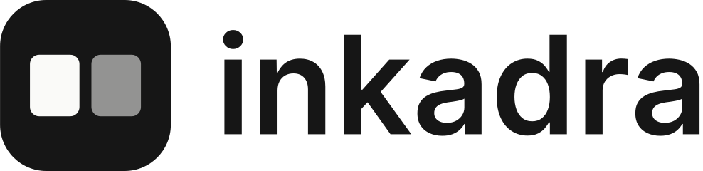
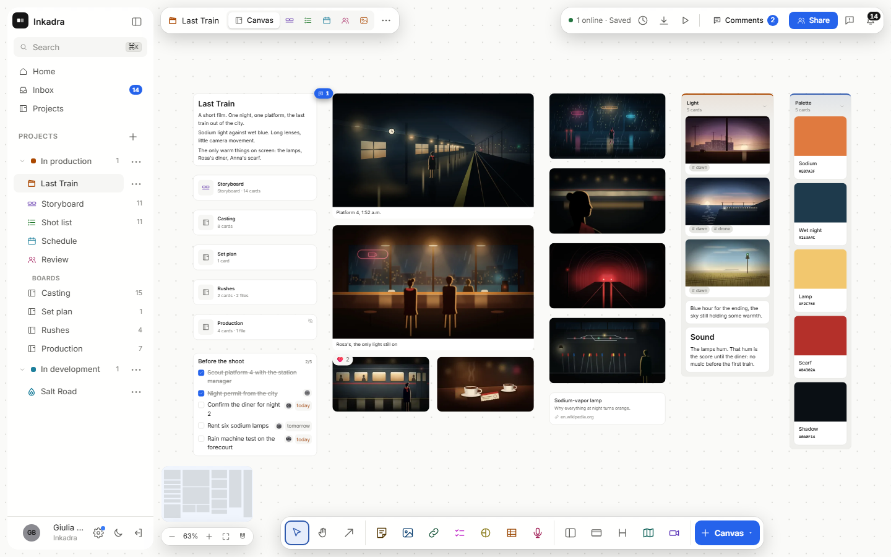
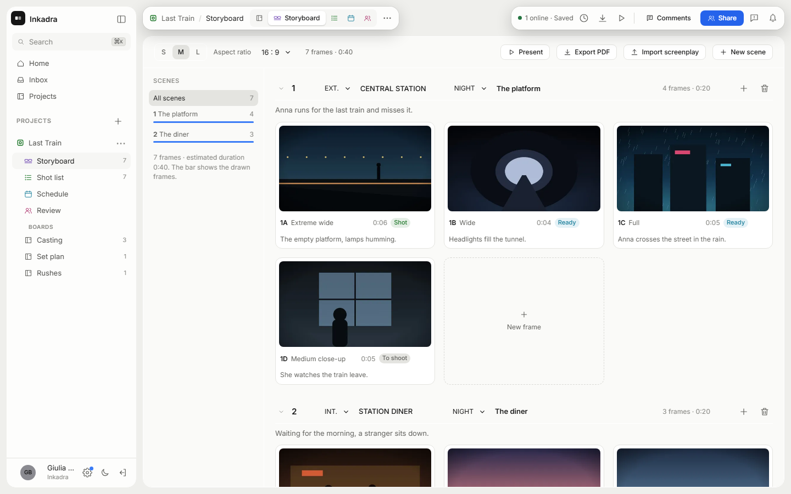
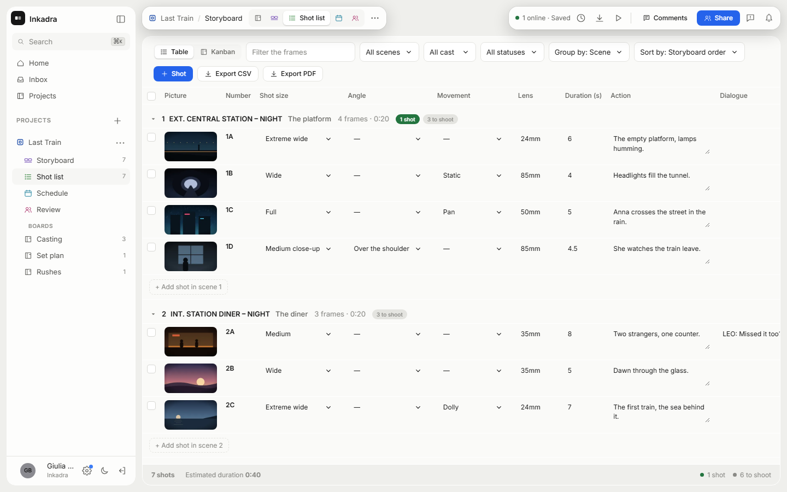
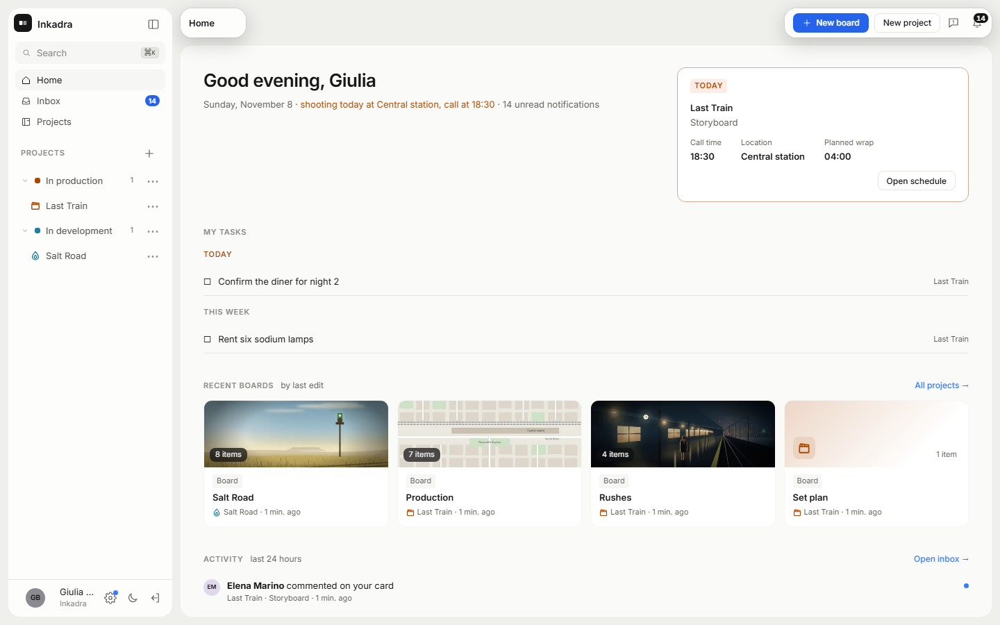

<p align="center">
  <picture>
    <source media="(prefers-color-scheme: dark)" srcset="docs/assets/logo-dark.svg">
    
  </picture>
</p>

<p align="center">
  <strong>Self-hosted boards for film and photography. From idea to frame.</strong>
</p>

<p align="center">
  <a href="https://github.com/inkadra/inkadra/actions/workflows/ci.yml"></a>
  <a href="https://github.com/inkadra/inkadra/releases"></a>
  <a href="https://github.com/inkadra/inkadra/pkgs/container/inkadra"></a>
  <a href="#licence"></a>
</p>

<p align="center">
  <a href="https://demo.inkadra.com">Try the demo</a> ·
  <a href="https://inkadra.com">Website</a> ·
  <a href="docs/guide.md">Tour</a> ·
  <a href="docs/self-hosting">Self-hosting guide</a> ·
  <a href="https://github.com/inkadra/inkadra/wiki">Documentation</a> ·
  <a href="CONTRIBUTING.md">Contributing</a>
</p>

<p align="center">
  <picture>
    <source media="(prefers-color-scheme: dark)" srcset="docs/screenshots/readme/board-dark.png">
    
  </picture>
</p>

Inkadra is a free, open source workspace for people who make films and photographs:
moodboards, storyboards, shot lists, set plans and client review on an infinite canvas, on your
own server.

**[Try the demo](https://demo.inkadra.com)** in your browser, with no account: a private sandbox
for one hour with two sample projects, a short film and a photo shoot.

> [!NOTE]
> Inkadra is not at 1.0 yet. Try it, but keep backups of work you cannot afford to lose, and
> read [Upgrades](docs/self-hosting/upgrades.md) before updating: versions before 1.0 may
> change things between minor releases.

## What it does

- Boards on an infinite canvas: notes, images, files, links, to-do lists, colours, tables, maps,
  voice notes, columns, arrows and boards inside boards. Uploaded videos and YouTube and Vimeo
  links play inside their card.
- Storyboards of scenes and frames, with shot size, angle, movement, lens, cast and status. Draw
  on a frame, drop a picture on it or take a still from a video. Import a screenplay (Fountain,
  Final Draft or PDF), and update the storyboard when the script is revised.
- The shot list is the same frames as a table, with filters and CSV and PDF export.
- A Production board per project: the shooting schedule of every storyboard, the crew and the
  call sheets.
- Set plans drawn to scale, with cameras, lights, actors and movement, and the kit list. Character
  sheets with story, relations, references and costume.
- Live collaboration: roles per project and board, comments with mentions, an inbox for
  notifications, and named versions to go back to.
- Client review through a share link, with or without comments and picks; some cards can stay
  for the team only.
- The [Inkadra Clipper](apps/clipper) saves images, quotes and links from Chrome, Edge, Brave and
  Arc onto a board. Install it from the
  [Chrome Web Store](https://chromewebstore.google.com/detail/inkadra-clipper/hdajoikapihpjfbgioeagenmoalckjkh)
  (it needs a server on 0.9 or later).
- Docker images for amd64 and arm64. Files on a volume, a host folder or S3 storage. Sign-in with
  email, Google or your own OIDC provider, with two-factor authentication.
- Export a project as an open zip archive and import it on any Inkadra server. Nightly backups of
  the database.
- Works in a phone's browser and installs as an app. Interface in English, Italian, Spanish,
  German, French and Brazilian Portuguese.

Storyboard, Production, Moodboard, Client review and Set plan are modules: each person can turn
off the ones they do not use in **Settings → Modules**. [The tour](docs/guide.md) shows each tool
with pictures.

<table>
  <tr>
    <td width="50%">
      <picture>
        <source media="(prefers-color-scheme: dark)" srcset="docs/screenshots/readme/storyboard-dark.png">
        
      </picture>
      <p align="center"><sub>Storyboard: scenes, frames and the data of each shot</sub></p>
    </td>
    <td width="50%">
      <picture>
        <source media="(prefers-color-scheme: dark)" srcset="docs/screenshots/readme/shotlist-dark.png">
        
      </picture>
      <p align="center"><sub>Shot list: the same frames as a table</sub></p>
    </td>
  </tr>
  <tr>
    <td colspan="2">
      <picture>
        <source media="(prefers-color-scheme: dark)" srcset="docs/screenshots/readme/home-dark.png">
        
      </picture>
      <p align="center"><sub>Home: today's shoot, recent boards and what changed</sub></p>
    </td>
  </tr>
</table>

## Run it

You need a machine with Docker and Compose. To try Inkadra on your own computer:

```sh
mkdir inkadra && cd inkadra
curl -fsSLO https://raw.githubusercontent.com/inkadra/inkadra/main/compose.yaml
curl -fsSL -o .env https://raw.githubusercontent.com/inkadra/inkadra/main/.env.example
sed -i "s/^AUTH_SECRET=.*/AUTH_SECRET=$(openssl rand -hex 32)/; s/^POSTGRES_PASSWORD=.*/POSTGRES_PASSWORD=$(openssl rand -hex 16)/" .env
sed -i "s#^PUBLIC_URL=.*#PUBLIC_URL=http://localhost:3000#" .env
docker compose up -d --wait
```

Open <http://localhost:3000>: the first account you create becomes the administrator.

For real work you need a domain and HTTPS. [The self-hosting guide](docs/self-hosting) starts
from zero and covers reverse proxies, sign-in, storage, backups, upgrades and troubleshooting.

> [!IMPORTANT]
> People can report a problem from inside the app. Unless an administrator turns it off, a report
> that someone writes, previews and sends goes to the Inkadra developers through a relay on
> Cloudflare. Nothing else is sent: Inkadra has no telemetry.
> [What leaves your server](docs/self-hosting/README.md#what-leaves-your-server) explains how to
> turn it off.

## Contributing

Read [CONTRIBUTING.md](CONTRIBUTING.md): it covers the setup, the layout of the repository and
the rules for pull requests. [docs/decisions](docs/decisions) records why the main choices were
made. Report security problems through a [private advisory](SECURITY.md), not a public issue.

## AI-assisted development

Much of Inkadra's code, tests and reviews are written with AI coding agents, directed by the
maintainer. Every change goes through CI, tests and review before it is merged, but mistakes are
still possible: keep backups and [report what you find](https://github.com/inkadra/inkadra/issues/new/choose).

## Support

Inkadra is free, with no ads and no tracking. If it helps your work, you can
[buy me a coffee on Ko-fi](https://ko-fi.com/teovader). Stars, bug reports and word of mouth help
too.

## Licence

The server, the web app and the rest of this repository are under the
[GNU Affero General Public License v3.0](LICENSE): if you run a modified Inkadra for other people
over a network, you must offer them the source of your version. The shared packages in
`packages/` and the browser extension are under the
[Mozilla Public License 2.0](packages/shared/LICENSE), and so will be the mobile app. See
[decision 0008](docs/decisions/0008-licences-per-component.md).

The name "Inkadra" and the logo are not covered by these licences: a modified version or a
hosting service needs its own name. See [TRADEMARKS.md](TRADEMARKS.md).
