# A tour of Inkadra

What the main tools do and where to find them. The pictures come from the sample project that
`pnpm --filter @inkadra/e2e screenshots` builds on an empty instance: every name and image in them
is invented.

## Tutorials

The first time you sign in, Inkadra offers a one-minute tour of the interface. Each feature has a
tour of three steps, offered by a small pill the first time you open it; skip it and it waits in
**Settings → Tutorial**, where you can replay any tour, see which ones are new, turn the pills off
or start over. Guests of a review link get two steps, and **?** in their header plays them again.

## The board

A board is an infinite canvas. The **dock** at the bottom holds the tools that add cards: notes,
pictures, links, to-do lists, colours, tables, voice notes, columns, sections, maps and more.
**+ ▾** at its end opens everything, and **Settings → Toolbar** chooses which tools stay in the dock.
Panels never cover it: it moves over when one opens. On a phone the dock shows the first few tools
above the navigation bar, and the rest are under **+**.

Select a card and a **toolbar** appears above it, with what that card can do: a note's text style,
lists, links and colours while you type, a section's size and colour, a link's info and preview, or
Draw on a picture. **Done**, `Esc` or a click elsewhere closes it.

<picture>
  <source media="(prefers-color-scheme: dark)" srcset="screenshots/guide/toolbar-dark.png">
  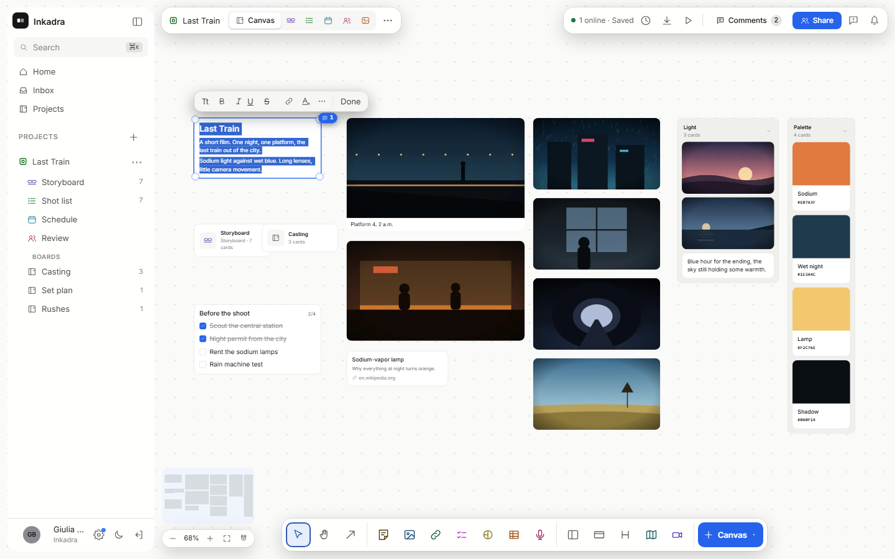
</picture>

  <picture>
    <source media="(prefers-color-scheme: dark)" srcset="screenshots/guide/phone-dark.png">
    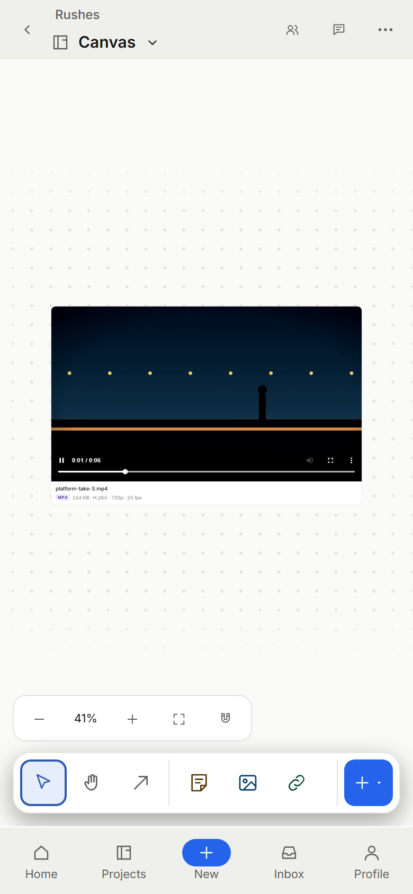
  </picture>

## Videos in their card

An uploaded video plays inside its card: press play and it runs there, with its controls, without
opening anything. One plays at a time. Video links from YouTube and Vimeo play in their card as well.
With the [standard image](self-hosting/README.md#the-image), formats that browsers cannot play get a
playable copy, and a video gets a poster and its details.

<picture>
  <source media="(prefers-color-scheme: dark)" srcset="screenshots/guide/video-card-dark.png">
  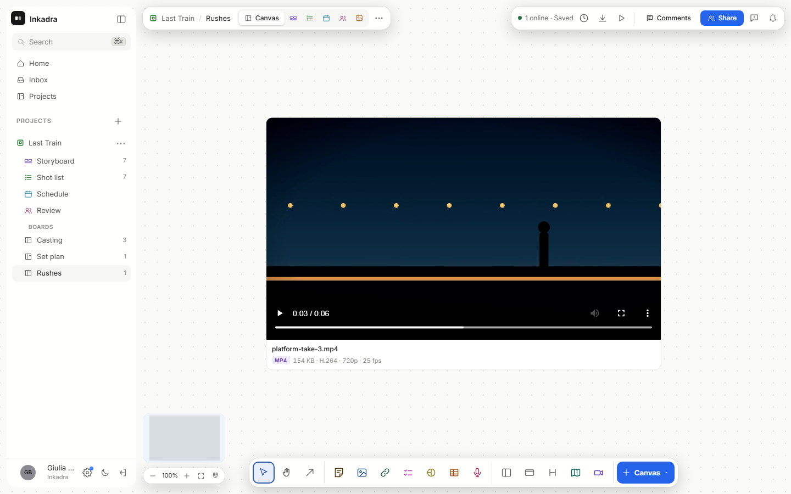
</picture>

## Storyboards, frames and Draw

A storyboard is made of scenes and frames, and it has more views of the same data: the shot list, the
schedule and the review. Double-click a frame to open its panel: action, shot size, angle, movement,
lens, cast and status. The panel follows your selection, and closes when you pick
something else.

Drag a picture from the board onto a frame and it becomes the frame's picture and leaves the board,
with an Undo. A card that holds strokes, a crop, a rotation or a caption stays, because a frame has
no place for those. A still from a video comes from the original file on the server when the
standard image is there, at full quality.

<picture>
  <source media="(prefers-color-scheme: dark)" srcset="screenshots/guide/frame-panel-dark.png">
  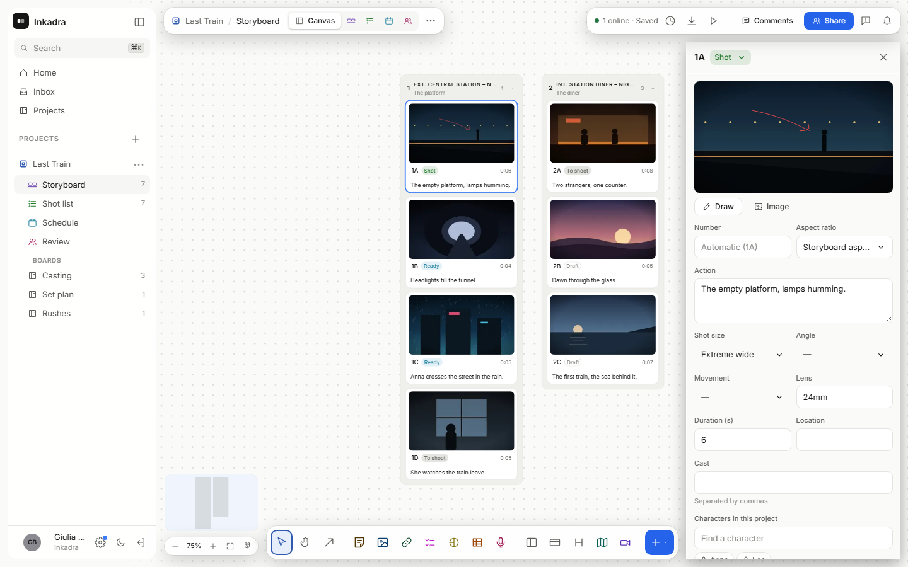
</picture>

**Draw** opens the frame full screen, with one floating bar: pens, eraser, shapes, text, colour and
size. The arrows `←` `→` go to the other frames. Ink starts red on a photo and dark on a blank
frame. Move around with space and drag, the wheel or two fingers.

<picture>
  <source media="(prefers-color-scheme: dark)" srcset="screenshots/guide/draw-dark.png">
  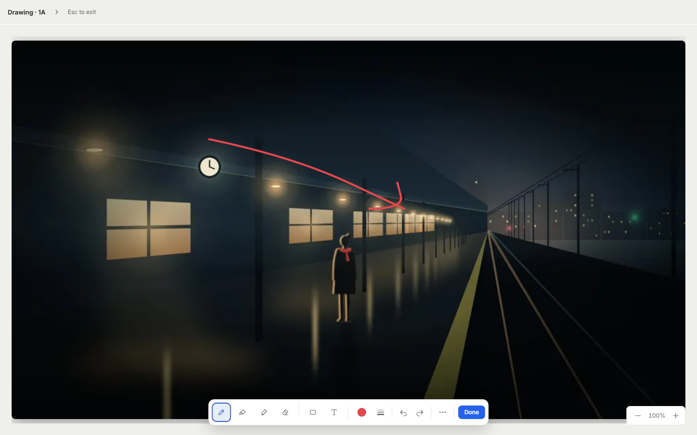
</picture>

<table>
  <tr>
    <td width="50%">
      <picture>
        <source media="(prefers-color-scheme: dark)" srcset="screenshots/readme/storyboard-dark.png">
        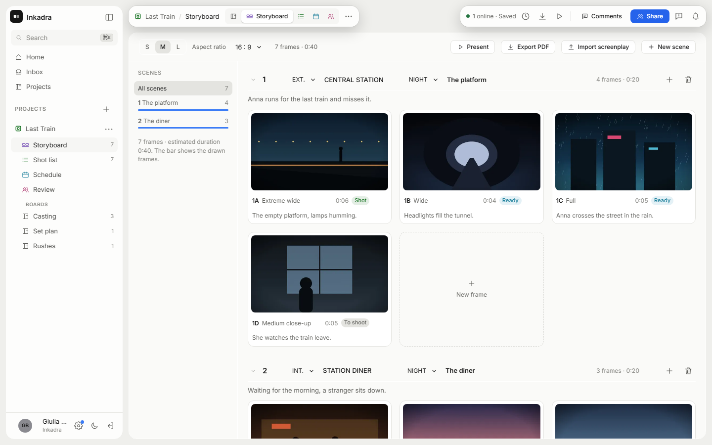
      </picture>
      
Storyboard

    </td>
    <td width="50%">
      <picture>
        <source media="(prefers-color-scheme: dark)" srcset="screenshots/readme/shotlist-dark.png">
        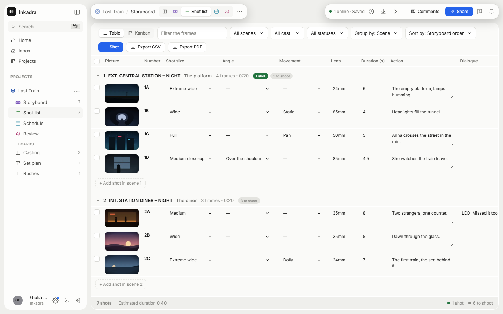
      </picture>
      
Shot list

    </td>
  </tr>
</table>

## Set plans

A set plan is a card with a drawing of the location. Double-click it to open the editor, which
takes the whole screen: the library on the left, the drawing in the middle with its tools at the
bottom, and a panel on the right with **Properties**, **Elements** and **Kit**. Nothing floats over
the drawing.

- **Library**: 163 types in six categories on the rail (lights; modifiers and grip; camera and
  movement; people; set and props; sound and video), plus annotations. Search finds names, the
  other names crews use and categories; `Enter` places the first result in the middle. Click a
  type and then the plan, or drag it there; hold `Shift` to keep placing. The star keeps a type
  among your favourites, next to the recent ones and the **project kit**: the lights and cameras
  already set up in the plans of every board of the project you can open, with their make,
  power, modifiers and stand. Offline it shows the kit of the open board only, and says so.
- **Snapping**: drop a person on a chair, sofa or bed, a modifier on the front of a light, a
  light or a camera on a stand or support, a dolly on a track: the target lights up and the icon
  attaches. Moving or turning the base takes what is on it along; pull an icon away to detach it.
  Hold `Alt` while dropping to place it free (on a phone, turn off **Snap** in the header).
- **Properties** shows what is selected: a light's role, fixture, watts, make, modifiers, gel,
  stand, colour temperature, intensity, beam, height, tilt and circuit; a camera's lens, sensor,
  support, height, angle, view length and positions; a person's pose, seat and movement; a prop's
  width and depth. With several items selected: align, layer, colour and group. **Bring forward**
  and **Send back** are in the selection's menu (right click, or `]` and `[`). **Lock** keeps
  the selected items where they are: a locked item can still be picked, to unlock it, but it is
  not moved, turned, resized, edited or deleted, and nothing new snaps onto it.
- **Elements** lists the plan by group (Lights, Camera, Actors, Grip and crew, Set, Notes),
  filtered by group or colour, with a lock on each locked item. A layer's eye and lock hide and
  lock the layer; those of Grip and crew hide its flags, stands and crew for you and lock each
  of them. **Kit** counts the kit of the setup and its power per circuit at 120 or 230 V:
  a circuit turns orange above 80 % of its breaker and red above it. **Copy list** copies it;
  the call sheet prints the kit of the plans of its scenes.
- **Setups** are the tabs at the top; **+** copies the current one. On a setup, a note says what
  changed from the base, which can be shown faintly behind it.
- **Scale** sets the metres from a line of known length; a number written on a measure is a
  label, and on a plan without a scale Inkadra offers to use that line as the scale.

On a phone the plan is on top, the selection in a sheet under it and the tools at the bottom; the
library, Elements and Kit open as sheets. People who cannot edit a plan, guests first, can open it
to look and zoom.

<picture>
  <source media="(prefers-color-scheme: dark)" srcset="screenshots/guide/set-plan-dark.png">
  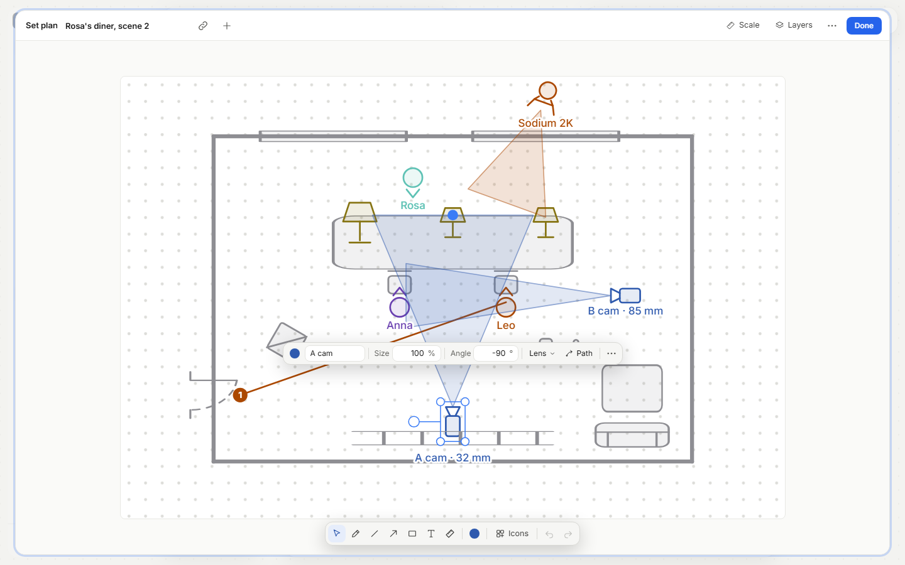
</picture>

## Character sheets

A character card opens a panel of collapsible sections: identity, appearance with reference pictures,
story (what they want, what they fear, how they change), relations to other characters, costume and
makeup, scenes, and team-only notes. Scenes are worked out from the frames whose cast names the
character, and you can add others by hand. Guests see all of it except Contact and Notes. A location
card has the same kind of panel, with fewer fields.

<picture>
  <source media="(prefers-color-scheme: dark)" srcset="screenshots/guide/character-dark.png">
  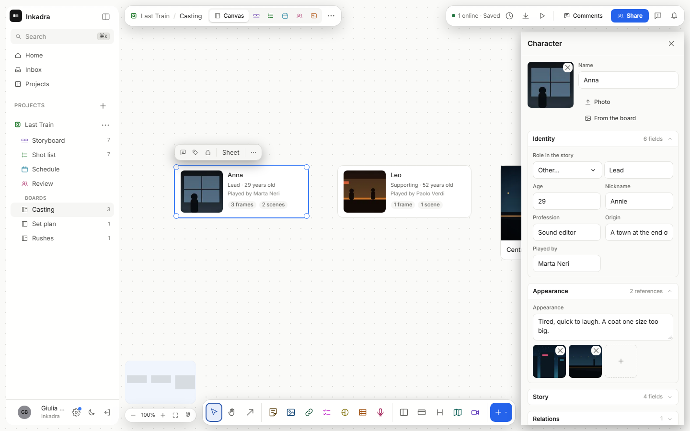
</picture>

## Comments

**Comments** at the top right opens one column with the whole conversation of the board. **Show on
board** puts bubbles next to the cards with open threads, and **Mentions and replies** narrows the
list to what concerns you.

Every comment has a visible audience: **Team** (people with a role on the board) or **Also guests**
(guests of a share link that can read comments). It goes back to Team after you send and on every
draft, so a comment reaches a guest only when you choose so each time.

<picture>
  <source media="(prefers-color-scheme: dark)" srcset="screenshots/guide/comments-dark.png">
  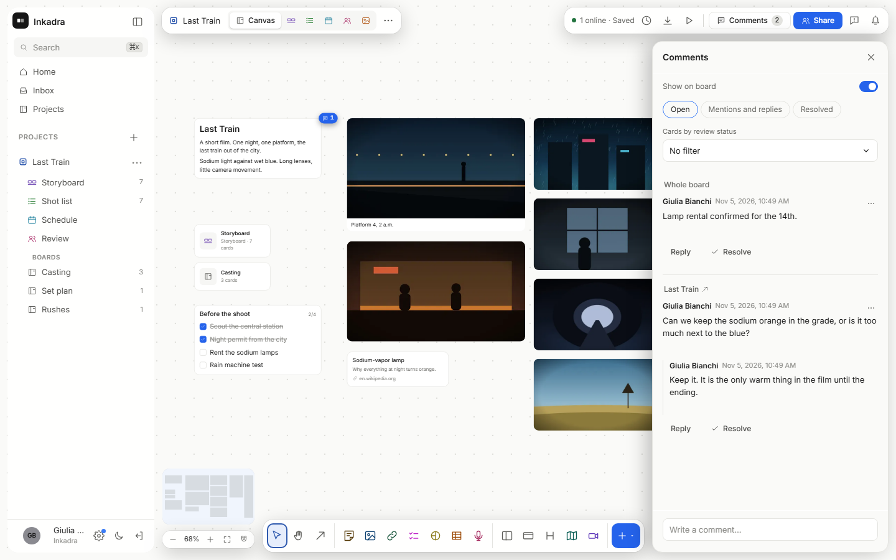
</picture>

## Classifications

Administrators set the instance's lists in **Settings → Classifications**: project types, tags, and
for storyboards shot size, angle and movement. They apply to every project. Rename a value and it
changes on every frame that uses it. Archive one and it leaves the menus but stays on the frames that
have it. **Other…** in a frame's menu still takes free text, and **Reactivate default values** brings
back the archived defaults of the three storyboard lists. A default keeps its translation until it is
renamed.

<picture>
  <source media="(prefers-color-scheme: dark)" srcset="screenshots/guide/classifications-dark.png">
  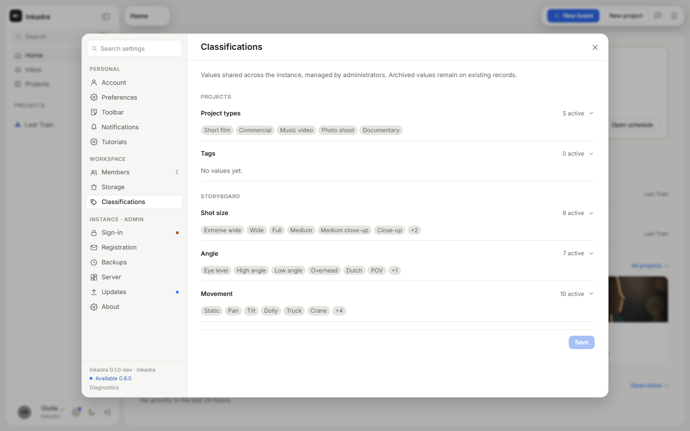
</picture>

## Reporting a problem

The icon next to the notifications, `Ctrl/⌘+Shift+B` or **Settings → About** opens the report: a bug,
an idea or a question, with a screenshot of the page that you can draw on or blur, a recording up to
60 seconds, or files. **Preview** shows exactly what leaves, and you choose what to keep.

The automatic screenshot leaves out the sidebar, the account, the breadcrumbs, your tasks, and project
and people names in activity. The rest of the page leaves as it is: cover it by hand if needed. A
shared tab or an image you choose leaves whole.

Where it goes is up to whoever runs the instance. Unless they chose otherwise, it goes to the Inkadra
developers: [What leaves your server](self-hosting/README.md#what-leaves-your-server) says what that
means and how to turn it off. The dialog also says where the report is going.

<picture>
  <source media="(prefers-color-scheme: dark)" srcset="screenshots/guide/report-dialog-dark.png">
  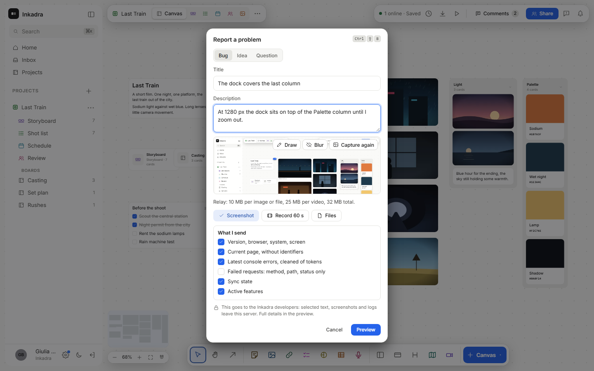
</picture>
