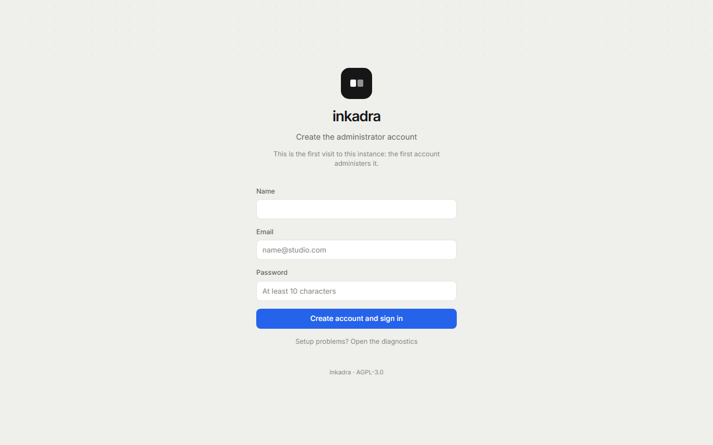
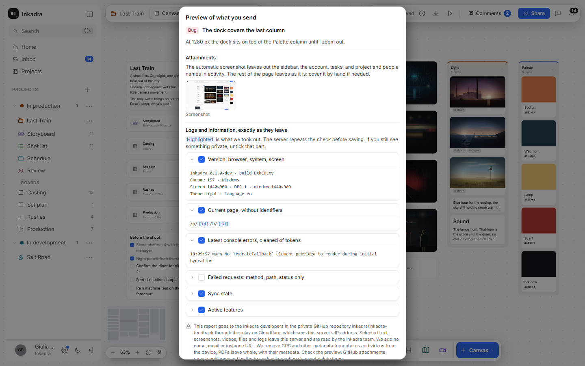
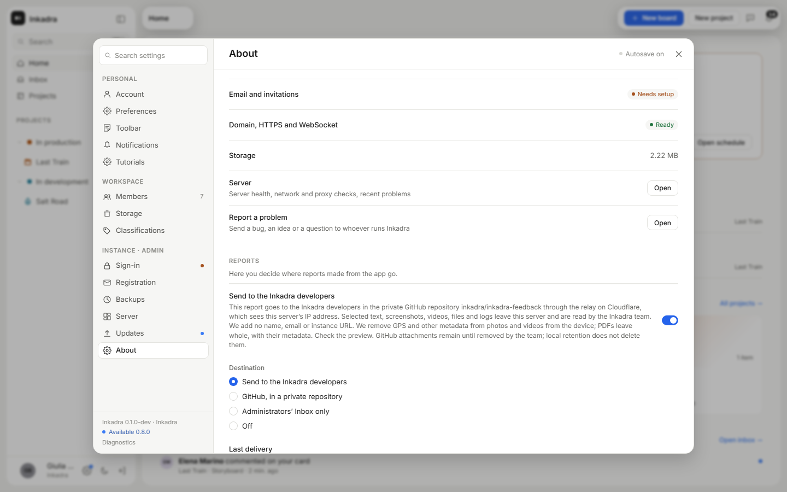

# Self-hosting

Run Inkadra with Docker Compose on an amd64 or arm64 machine. The default setup runs the app, PostgreSQL and Valkey.

This guide follows `main`. The latest release is **0.9.0 (9 November 2026)**. Changes after that
release are marked below and in [Upgrades](upgrades.md#after-090-current-main).

| Page                                  | What it covers                                       |
| ------------------------------------- | ---------------------------------------------------- |
| This page                             | Installing, the image variants, backups, what leaves |
| [Configuration](configuration.md)     | Every setting in `.env`                              |
| [Sign-in](sign-in.md)                 | Google, OIDC, email, invitations, two-factor         |
| [Reverse proxy](reverse-proxy.md)     | Caddy, Traefik, Nginx, Nginx Proxy Manager, Pangolin |
| [Storage](storage.md)                 | Volumes, data on different disks, S3, bundled RustFS |
| [Upgrades](upgrades.md)               | Versions, updating, verifying images                 |
| [Troubleshooting](troubleshooting.md) | What to check when something does not work           |
| [Office previews](office.md)          | The optional LibreOffice worker                      |

## What you need

- A Linux machine, amd64 or arm64, with 2 GB of RAM and disk space for your files. Windows and
  macOS work through Docker Desktop, for trying Inkadra out.
- **Docker Engine 24 or newer with Compose 2.24.4 or newer.** Install it from
  [Docker's guide](https://docs.docker.com/engine/install/) or install [Docker Desktop](https://docs.docker.com/desktop/). On Linux,
  to run `docker` without `sudo`, add yourself to its group and sign in again:
  `sudo usermod -aG docker $USER`. Check that it works:

  ```sh
  docker compose version     # Docker Compose version v2.24.4 or newer
  docker run --rm hello-world
  ```

- `curl` and `openssl`, which most systems already have.
- For real work, a (sub)domain such as `inkadra.example.com` pointing at the machine, and a
  reverse proxy that serves it over HTTPS. The repository has
  [proxy examples](#with-a-proxy-in-the-same-stack). For local testing, use `http://localhost:3000`.

## Install

Compose starts three containers from one file, `compose.yaml`, and reads your settings from a
second one, `.env`, in the same folder. Run every `docker compose` command from that folder.

1. **Make a folder and download the two files.**

   ```sh
   mkdir inkadra && cd inkadra
   curl -fsSLO https://raw.githubusercontent.com/inkadra/inkadra/main/compose.yaml
   curl -fsSL -o .env https://raw.githubusercontent.com/inkadra/inkadra/main/.env.example
   ```

2. **Fill in the two secrets.** This writes random values into `.env` (on macOS, use
   `sed -i ''`). Keep the file private: anyone who reads it can get into the database.

   ```sh
   sed -i "s/^AUTH_SECRET=.*/AUTH_SECRET=$(openssl rand -hex 32)/; s/^POSTGRES_PASSWORD=.*/POSTGRES_PASSWORD=$(openssl rand -hex 16)/" .env
   ```

3. **Set the address** people will use, in `PUBLIC_URL`, with any text editor. To try Inkadra on
   this computer, use `http://localhost:3000`:

   ```sh
   sed -i "s#^PUBLIC_URL=.*#PUBLIC_URL=http://localhost:3000#" .env
   ```

   For a server, use its HTTPS address, such as `https://inkadra.example.com`, without a path or
   a trailing slash.

4. **Start it.** The first start downloads the images. The `--wait`
   option returns when everything is ready.

   ```sh
   docker compose up -d --wait
   docker compose ps          # inkadra, postgres and valkey should say "healthy"
   curl -s http://127.0.0.1:3000/api/v1/health     # {"status":"ok",…}
   ```

5. **Point your reverse proxy at port 3000** of this machine, unless you are only trying it out.
   See [Reverse proxy](reverse-proxy.md), or use a [bundled one](#with-a-proxy-in-the-same-stack).

6. **Create the administrator.** Open `PUBLIC_URL` in a browser. The first visit asks for a name,
   an email and a password of at least 10 characters: that account administers the instance.
   Without [email configured](sign-in.md) no message is sent, so the address does not have to
   work yet. After that, sign-up is closed:
   other people join through an invitation (see [Sign-in](sign-in.md)), or anyone can sign up if
   you set `REGISTRATION=open`.

   <picture>
     <source media="(prefers-color-scheme: dark)" srcset="../screenshots/guide/first-run-dark.png">
     
   </picture>

Open **Settings → General** to review setup and **Settings → Server status** to check services.

> [!IMPORTANT]
> **Reports go to the Inkadra developers by default.** People can report a problem from inside
> the app, and unless you choose otherwise the report goes to the developers. Nothing leaves
> until someone writes a report, sees its preview and sends it. Read
> [What leaves your server](#what-leaves-your-server) and decide before you invite anyone.

To stop Inkadra, run `docker compose stop`; to start it again, `docker compose up -d`.
`docker compose down` also removes the containers, and keeps your data. Only
`docker compose down -v` deletes the data, so do not use that one.

The downloaded Compose file defaults to `latest`, the stable image, not `edge`. For a stable
install, use the deployment files attached to the
[release](https://github.com/inkadra/inkadra/releases); they pin `INKADRA_TAG` and match that
version. Use `INKADRA_TAG=edge` only to try current `main`.

### Updating

Read the [release notes](https://github.com/inkadra/inkadra/releases) and [back up](#backups), set
the new version in `INKADRA_TAG` in `.env` if you pinned one, then follow [Upgrades](upgrades.md#updating), including any steps for older versions.

### With a proxy in the same stack

If nothing else uses ports 80 and 443 on the machine, let Compose run the proxy too. The domain
must already point at the machine. Download the repository files (or the release archive), fill in
`.env` as in steps 2 and 3, with the HTTPS address in `PUBLIC_URL`, add its host as `INKADRA_DOMAIN`,
and add the proxy's file:

```sh
git clone --depth 1 https://github.com/inkadra/inkadra.git && cd inkadra
cp .env.example .env     # then steps 2 and 3 above
echo INKADRA_DOMAIN=inkadra.example.com >> .env
docker compose -f compose.yaml -f deploy/proxy/caddy/compose.yaml up -d --wait
```

Caddy gets the certificate by itself. Traefik and Nginx are there too; see
[Reverse proxy](reverse-proxy.md).

### Portainer, Dockhand, TrueNAS and other stack managers

Stack managers take a single compose file. To use a variant, let Compose merge the files and
paste the result:

```sh
docker compose -f compose.yaml -f deploy/compose.split.yaml config > stack.yaml
```

`config` writes the values of `.env` into `stack.yaml`, secrets included: keep that file private,
or run it with an `.env` that has placeholders and fill them in the manager's environment
editor. On TrueNAS, keep the data on a dataset: see [Storage](storage.md#a-folder-on-the-host).

## Installing as an app

People can install Inkadra from the browser as an app with its own window and icon: in Chrome
and Edge with the install button in the address bar, on Android with _Add to home screen_, in
Safari on iPhone and iPad with _Share → Add to Home Screen_, in Safari on the Mac with
_File → Add to Dock_. There is nothing to configure on the server, but the browser only offers it
over **HTTPS** with a valid certificate (or on `localhost`): on plain HTTP the app keeps working
in the browser, without the install option, the offline page and the update prompt.

The app is the same web app, so it needs the server: without a connection it shows an offline
page and reloads by itself when the network is back. After you upgrade Inkadra, open apps and
tabs show _New version available — Update_; until someone presses it they keep running the
version they started with. If a board is still saving or an upload is running, the update
waits for them. The service worker that does this never stores API responses,
files, sign-in pages or anything tied to an account: see
[decision 0015](../decisions/0015-installable-web-app.md). A proxy in front of Inkadra must
serve `/sw.js` and `/manifest.webmanifest` as it receives them (the examples in `deploy/proxy`
do). Inkadra sends its own `Content-Security-Policy` (see
[Browser security headers](configuration.md#browser-security-headers)); a proxy that adds another
one needs `worker-src 'self'`, `manifest-src 'self'`
and must allow the inline `<script>` and `<style>` of `offline.html` and the inline theme script
of `index.html` (with `'unsafe-inline'` or their hashes).

## The image

`ghcr.io/inkadra/inkadra`, built for `linux/amd64` and `linux/arm64`, in two variants:

| Variant  | Tag example    | Contents                                                                                                                                   |
| -------- | -------------- | ------------------------------------------------------------------------------------------------------------------------------------------ |
| Standard | `edge`         | ffmpeg, exiftool, poppler and hardware encoding drivers: video posters and playable copies, audio waveforms, camera RAW and PDF thumbnails |
| Office   | `edge-office`  | Standard plus LibreOffice, for the **worker role only**: [Office previews](office.md), optional and experimental                           |

### Tags

| Tag           | What it is                                                  |
| ------------- | ----------------------------------------------------------- |
| `0.9.0`       | One release. Recommended: pin it in `INKADRA_TAG`           |
| `0.9`         | The latest patch release of 0.9                             |
| `latest`      | The latest stable release                                   |
| `edge`        | The latest commit of `main`: for testing, not for real work |
| `sha-1a2b3c4` | One commit                                                  |

Every tag also exists with the suffix `-office` (`0.9.0-office`, `latest-office`, `edge-office`…).
**In 0.9.0**, media tools still require `0.9.0-media`; `0.9.0` does not include them.
**After 0.9.0**, standard includes media tools and new builds no longer publish `-media`.
Remove the suffix only when moving to one of those builds. Keep `INKADRA_TAG` without
`-office` when using the [Office worker override](office.md#the-worker-image), which adds it.

### Media tools included in standard

Videos get a poster thumbnail on the board, their duration and codecs, and a playable H.264 copy
for unsupported or heavy originals. Current `main` stores several resolutions and can encode
while someone watches; see [Media previews](configuration.md#media-previews). Camera RAW files get
thumbnails from the JPEG the camera embedded, and PDFs a thumbnail of page 1 and their page
count.

The server reports what it can do in `GET /api/v1/instance` (`media.videoPosters`,
`media.videoProxies`, `media.rawPreviews`, `media.pdfPreviews`).
[Media previews](configuration.md#media-previews) lists the settings, and
[decision 0048](../decisions/0048-media-worker-previews.md) the limits.

The standard image includes Debian's `ffmpeg`, `libimage-exiftool-perl` and `poppler-utils` packages and the
libraries they depend on, and the free VAAPI and Quick Sync drivers (`mesa-va-drivers`,
`vainfo`, plus `intel-media-va-driver`, `libmfx-gen1.2` and `libvpl2` on amd64) for
[hardware video encoding](configuration.md#hardware-video-encoding). Licences: Debian builds
ffmpeg with GPL components, so that package is under the GPL (version 2 or later) and some of
its libraries under the LGPL; poppler is under the GPL too, and exiftool under the Perl licence
(GPL or Artistic). Their texts are in the image under `/usr/share/doc/<package>/copyright`. The
GPL is compatible with distributing Inkadra under the AGPL-3.0, and the server only runs the
`ffmpeg`, `ffprobe`, `exiftool`, `pdftoppm` and `pdfinfo` programs, without linking to them.

The office variant is the standard image plus LibreOffice, for the worker role only, when you
enable [Office document previews](office.md).

### Roles

The image's command selects the role. Each role has its own health check.

| Command                 | Role                                                                |
| ----------------------- | ------------------------------------------------------------------- |
| `all` (default)         | Web app, API, collaboration and background jobs in one container    |
| `web`                   | Web app and API on port 3000                                        |
| `collab`                | Real-time collaboration (WebSocket) on port 3001                    |
| `worker`                | Background jobs (thumbnails, email, maintenance)                    |
| `migrate`               | Apply database migrations and exit (`web` and `all` do it on start) |
| `unlock-auth`           | Clear the sign-in counters of one account, then exit                |
| `admin-2fa off`         | Turn off the "require 2FA for administrators" setting, then exit    |
| `backup create`         | Write a backup of the database to `/data/backups`, then exit        |
| `backup restore <file>` | Restore a backup into an empty database, then exit                  |

### Requirements and security

- **PostgreSQL 16 or newer**, with the `pg_trgm` extension available (it is in the standard
  `contrib` package and in the official images); a migration creates it as the database owner.
  `compose.yaml` runs PostgreSQL 18; to move an install from 16, see
  [Upgrades](upgrades.md#upgrading-to-postgresql-18).
- **Valkey 8 or newer, or Redis 7**, required in production by every role. `compose.yaml` runs
  Valkey 9.
- The server runs as user `node` (uid 1000) with a read-only root filesystem and no Linux
  capabilities, and writes only to `/data`. `compose.yaml` starts the container as root with
  four capabilities, only so that it can give `/data` to uid 1000 when a host folder belongs to
  someone else; it then switches to uid 1000, which drops them.

## Compose variants

`compose.yaml` is the all-in-one setup. Other files in `deploy/` change it when added with `-f`
after it; they combine, in this order:

| File                                | Changes                                                       |
| ----------------------------------- | ------------------------------------------------------------- |
| `deploy/compose.split.yaml`         | `web`, `collab` and `worker` in separate containers           |
| `deploy/compose.s3.yaml`            | Files in an S3-compatible bucket you already have             |
| `deploy/compose.rustfs.yaml`        | Files in a bundled S3-compatible store (RustFS)               |
| `deploy/compose.vaapi.yaml`         | Hardware video encoding on Intel or AMD GPUs (standard image) |
| `deploy/compose.nvidia.yaml`        | Hardware video encoding on NVIDIA GPUs (standard image)       |
| `deploy/proxy/<proxy>/compose.yaml` | A reverse proxy in the stack: `caddy`, `traefik` or `nginx`   |

Split mode is for larger teams: you can restart or scale the parts on their own, and a busy
worker does not slow down the web app. The proxy must send `/collab` to the `collab` container
on port 3001: with the bundled proxies, set `INKADRA_COLLAB_UPSTREAM=collab:3001` (Caddy,
Nginx) or add `deploy/proxy/traefik/compose.split.yaml` (Traefik).

```sh
INKADRA_COLLAB_UPSTREAM=collab:3001 docker compose -f compose.yaml -f deploy/compose.split.yaml -f deploy/proxy/caddy/compose.yaml up -d
```

## Backups

Inkadra backs up its database every night, by default at 03:00 in the server's time zone (`TZ`),
and keeps the last 7 successful backups. Administrators change the schedule and retention, start a backup
and see the history in **Settings → Backups**. Backups need the `worker` role (in `all` it is
always there); without Valkey they run only when started from Settings.

A backup is one zip, `inkadra-backup-<date>-<id>.zip`, in `/data/backups` (the `inkadra-data`
volume or your `INKADRA_DATA` folder). When files are in S3 it is also copied to `backups/` in
the bucket. It holds database rows and a file inventory, with
[exclusions](../formats/instance-backup.md) for derived data and job bookkeeping. It does not
contain the files: files never change once written, so **back up the
data volume or the bucket too**, with your usual tool (restic, Borg, a snapshot of the volume,
bucket versioning or replication). The format is described in
[instance-backup.md](../formats/instance-backup.md).

These backups stay on the same disk as your files, so they do not protect you from losing that
disk. **A complete backup, copied to another machine, is:**

1. the data: the `inkadra-data` volume or your `INKADRA_DATA` folder, which holds the nightly
   zips too, or the bucket;
2. your `.env`, because `AUTH_SECRET` is needed to read two-factor secrets and sealed tokens;
3. if you copy whole folders, `POSTGRES_DATA` and `VALKEY_DATA` too, with the containers stopped:
   see [Data on different disks](storage.md#backing-up-the-folders).

To copy the default data volume to the current folder:

```sh
docker run --rm -v inkadra_inkadra-data:/from -v "$PWD":/to alpine tar czf /to/inkadra-data.tgz -C /from .
```

Backups contain password hashes, sessions and sealed tokens: keep them as safe as the database,
and never make the `backups/` prefix of a bucket public. They are not downloadable from the
browser; copy them from the server:

```sh
docker compose cp inkadra:/data/backups ./inkadra-backups
```

To take one from the command line, for example before an upgrade:

```sh
docker compose exec -u node inkadra node /app/dist/main.js backup create
```

Projects can also be exported one by one (**⋯ → Export project…**) and imported on any Inkadra
server; that is for moving work, not for restoring a server.

### Restoring

In split mode, use the same `-f` files for every command and stop `inkadra`, `collab` and
`worker` before restoring.

A backup restores into an **empty** database, with the same or a newer version of Inkadra
(migrations added since the backup are applied after the data). A backup made by a newer
version is refused. Keep the same `AUTH_SECRET`: sealed tokens and two-factor secrets need it.

```sh
docker compose stop inkadra
# Bring back the files first if they were lost: the data volume or the bucket.
docker compose exec postgres dropdb -U inkadra inkadra
docker compose exec postgres createdb -U inkadra inkadra
docker compose run --rm inkadra backup restore /data/backups/inkadra-backup-20261102-030000-0193f0a4.zip
docker compose up -d
```

The restore loads the tables in order, rebuilds the search index on the next start, and lists
any file named by the backup that storage does not have (a warning, not an error: restore the
volume or the bucket and they come back). To restore a backup copied elsewhere, put it in the
data folder first, for example with `docker compose cp`.

## What leaves your server

Inkadra sends no telemetry. It talks to other servers only for what is listed here.

| What                                                                        | Goes to                                                               | When                                                                   | To turn it off                                                 |
| --------------------------------------------------------------------------- | --------------------------------------------------------------------- | ---------------------------------------------------------------------- | -------------------------------------------------------------- |
| **Reports**: the text, screenshots, videos, files and logs someone selected | The Inkadra developers, through a relay on Cloudflare (details below) | Only when someone sends a report, after its preview. **On by default** | **Settings → Reports**, or `FEEDBACK_RELAY_URL=` empty |
| Map tile requests, with this instance's address in the user agent           | `tile.openstreetmap.org`, or your `MAP_TILE_URL`                      | When someone adds or explores a map or a GPX file                      | `MAPS=false`, or your own tile server                          |
| Requests for the pages behind pasted links, and their preview images        | That site; YouTube and Vimeo for their videos                         | When someone pastes a link or clips a page                             | No setting                                                     |
| Address lookups                                                             | Your `MAP_GEOCODER_URL`                                               | When someone types an address in a map card                            | Off unless you set it                                          |
| A request for the list of Inkadra releases, with no data about this server  | `api.github.com`                                                      | Every 6 hours, and on **Check now**. **On by default**                 | **Settings → Updates** → Tell me when a new version is out     |
| Sign-in, email and files                                                    | Your Google or OIDC provider, your mail server, your S3 bucket        | Only if you configure them                                             | Leave them empty                                               |

People's browsers load YouTube (from `youtube-nocookie.com`), Vimeo or Instagram players only when
someone plays a link card, and Google profile pictures for accounts that sign in with Google.

### Reports to the developers

Open **Report a problem** from the icon next to notifications,
`Ctrl/⌘+Shift+B`, or **Settings → Help and tutorials**. On every instance where no administrator has saved a
choice, new or upgraded, those reports go to the Inkadra developers.

**What leaves:** the title and description someone wrote and, if they kept them selected,
a screenshot, a recording, attached files, and diagnostics (version, browser and system, screen,
theme and language, the current page without identifiers, recent console errors, sync state and
active features). The person sees all of it in a preview, and can untick or blur what they want,
before anything is sent.

**What does not leave:** no name, email or instance address is added. Logs and text files lose
secrets, this server's host name and internal addresses; images and videos lose their metadata,
GPS included. PDFs leave whole, with their metadata, and the dialog says so. The automatic screenshot
leaves out the sidebar, the account, the breadcrumbs, tasks, and project and people names in
activity. What people write, or what is visible in the rest of a screenshot or in a file, can still
be personal or a client's: that is what the preview is for.

**Where it goes:** through a relay on Cloudflare, which sees this server's IP address, to the
private GitHub repository `inkadra/inkadra-feedback`, where the Inkadra developers read it.
Attachments stay in that repository until the developers remove them, whatever retention you set
here. Guests cannot report unless you allow them.

<picture>
  <source media="(prefers-color-scheme: dark)" srcset="../screenshots/guide/report-preview-dark.png">
  
</picture>

**To turn it off,** use either of these:

- In **Settings → Reports**, switch off _Send to the Inkadra developers_ (reports stay in
  the administrators' Inbox), or choose another destination: your own private GitHub repository,
  Inbox only, or Off. A saved choice always wins.
- Set an empty value in `.env`, then run `docker compose up -d`. The relay route is gone from this
  server and, without a saved choice, reports are off and the icon is hidden. On an existing
  instance, do this **before** upgrading to a version that has the relay.

  ```sh
  FEEDBACK_RELAY_URL=
  ```

<picture>
  <source media="(prefers-color-scheme: dark)" srcset="../screenshots/guide/reports-settings-dark.png">
  
</picture>

Limits, the direct GitHub route and how delivery retries work are in
[Configuration](configuration.md#in-app-reports).

### HTTP compression

The server negotiates gzip for JSON API responses of at least 1 KiB and for JavaScript and CSS
under `/assets/`, using Node's built-in zlib. No proxy compression setting is required. The static
plugin can serve precompressed files, but the web build does not produce those files.
Already encoded responses, media, ranged requests, downloadable files and API streams keep their
original encoding. Collaboration and WebSocket connections are unaffected. A proxy may compress
other text responses; it should preserve `Vary: Accept-Encoding` and existing `Content-Encoding`.

Inkadra is free and developed in the open; if it is useful to you, a donation on
[Ko-fi](https://ko-fi.com/teovader) helps keep it going. Tell us how your installation went and
what was unclear in this guide in [GitHub Discussions](https://github.com/inkadra/inkadra/discussions)
or an [issue](https://github.com/inkadra/inkadra/issues/new/choose).
